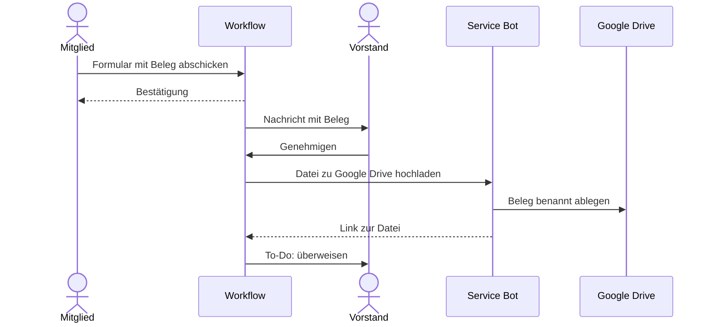
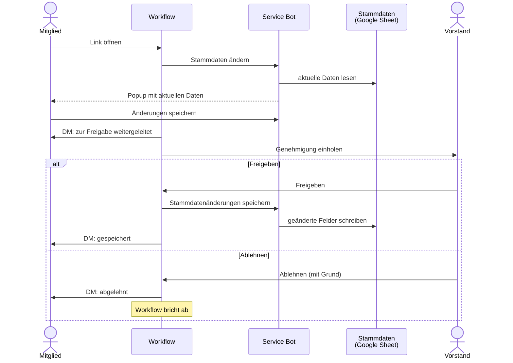
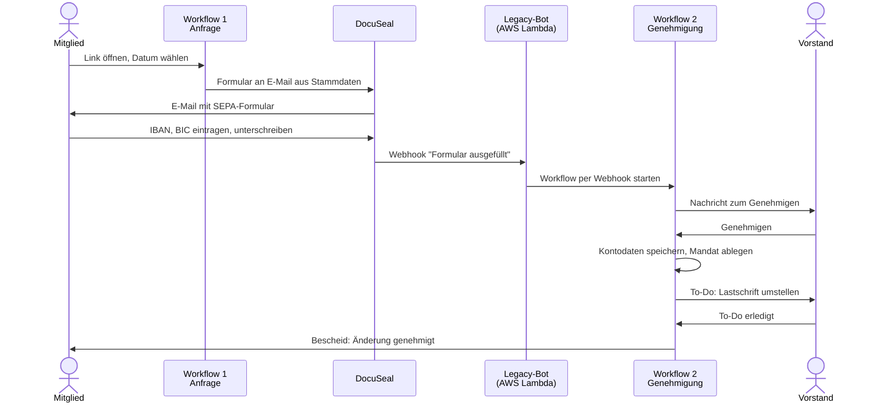
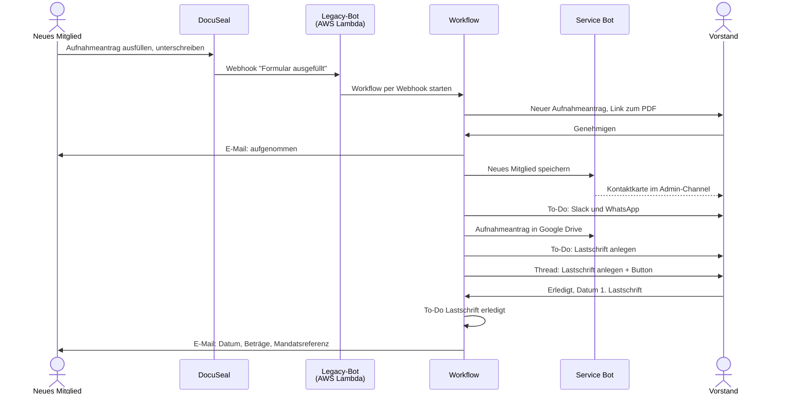
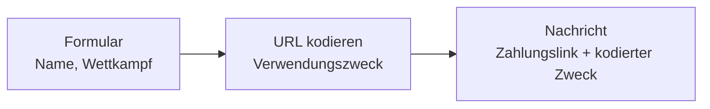

# Anleitung für Admins

Der Bot stellt keine fertigen Workflows bereit, sondern **Workflow-Schritte**. Diese werden im Slack **Workflow Builder** zu Workflows zusammengesetzt. Hier steht, wie die Workflows des Vereins aufgebaut sind und worauf beim Einrichten zu achten ist.

Wie Mitglieder die Workflows benutzen, steht in der [Anleitung für Mitglieder](./mitglieder).

## Überblick {#ueberblick}

| Bereich | Wer nutzt es | Beschreibung |
| --- | --- | --- |
| [Coaching-Vertrag](#coaching-vertrag) | Vereinscoaches | Workflow für Coaching-Verträge mit digitaler Unterschrift |
| [Rechnung einreichen](#rechnung-einreichen) | alle Mitglieder | Belege einreichen, genehmigen und ablegen |
| [Rechnung aus Nachricht](#rechnung-aus-nachricht) | Vorstand | Rechnungen aus E-Mails im Vorstands-Channel per Emoji-Reaktion einreichen |
| [Genehmigung einholen](#genehmigung) | freigegebene Mitglieder | Allgemeiner Schritt zum Freigeben oder Ablehnen, für beliebige Workflows |
| [Stammdaten ändern](#stammdaten-aendern) | alle Mitglieder | Eigene Mitgliedsdaten ändern, genehmigen und speichern |
| [Kontodaten ändern](#kontodaten-aendern) | alle Mitglieder | Neues SEPA-Mandat unterschreiben, genehmigen und speichern |
| [Neues Mitglied](#neues-mitglied) | Vorstand | Aufnahmeantrag in die Mitgliedsdaten übernehmen |
| [Austritt einplanen](#austritt) | Vorstand | Austrittsdatum nach einer Kündigung in den Mitgliedsdaten setzen |
| [Google Drive Ablage](#google-drive) | nur Admins | Schritt zum Hochladen von Dateien in Google Drive Ordner |
| [Datum & URL Bausteine](#bausteine) | alle Mitglieder | Hilfsschritte für Nachrichten und Links |

### Wer welche Schritte sieht {#freigaben}

Ein Schritt des Bots taucht im Workflow Builder nur bei den Personen auf, für die er freigegeben ist:

| Schritt | Freigegeben für |
| --- | --- |
| Datum formatieren, URL kodieren | alle Mitglieder |
| Coaching-Vertrag ausfüllen, Coaching-Vertrag senden | App-Inhaber:innen |
| Rechnung aus Nachricht einreichen | App-Inhaber:innen |
| Genehmigung einholen | App-Inhaber:innen und einzeln freigegebene Mitglieder |
| Stammdaten ändern, Stammdatenänderungen speichern | App-Inhaber:innen |
| Kontodaten-Änderung anfragen, Kontodaten-Formular senden, Kontodaten speichern | App-Inhaber:innen |
| Neues Mitglied speichern | App-Inhaber:innen |
| Austrittsdatum setzen | App-Inhaber:innen |
| Datei zu Google Drive hochladen | App-Inhaber:innen |

Wer einen Workflow **startet**, braucht keine Freigabe - die gilt nur für das **Bauen** von Workflows. Wie Freigaben geändert werden, steht in der Technischen Doku unter [Freigabe von Schritten](../technik/freigaben).

### Allgemeines zum Workflow Builder {#workflow-builder}

- Schritte des Bots findest du unter **Schritt hinzufügen** über die Suche nach dem Namen oder in der App **Schwerathletik Mannheim Bot**.
- Schlägt ein Schritt fehl, bricht der Workflow ab. Die Fehlermeldung (auf Deutsch) steht im Aktivitätsprotokoll des Workflows.
- Ausgaben eines Schritts stehen allen folgenden Schritten als Variablen zur Verfügung.

### Vorstands-To-Dos {#todos}

Viele Workflows enden mit einer Aufgabe für den Vorstand. Dafür wird mit dem Slack-Schritt **Element zur Liste hinzufügen** ein Eintrag in der Vorstands-internen Liste **To-Dos** angelegt:

| Feld | Inhalt |
| --- | --- |
| Name | Was zu tun ist, z. B. "Überweisen: Kreide und Tape" |
| Message | Referenz auf die Nachricht, zu der die Aufgabe gehört |
| Status | 1 - Neu |
| Priorität | je nach Workflow |
| Zuständigkeit | z. B. Kassenwart |

Einige Workflows warten darauf, dass das To-Do erledigt ist, und benachrichtigen dann das Mitglied (z. B. [Kontodaten ändern](#kontodaten-aendern)).

## Coaching-Vertrag {#coaching-vertrag}

Workflow, mit dem Vereinscoaches Coaching-Verträge erstellen und digital unterschreiben lassen ([Ablauf aus Sicht der Coaches](./mitglieder#coaching-vertrag)).

### Aufbau des Workflows {#coaching-aufbau}

| # | Schritt | Einstellungen |
| --- | --- | --- |
| – | **Start** | per Link, angepinnt im Vereinscoaches-Channel |
| 1 | **Coaching-Vertrag ausfüllen** | *Interaktivität*: die Interaktion, die den Workflow gestartet hat |
| 2 | **Coaching-Vertrag senden** | siehe unten |

Einstellungen für **Coaching-Vertrag senden**:

| Eingabe | Wert |
| --- | --- |
| Vorlagen-ID | ID der Coaching-Vertragsvorlage in DocuSeal (fest eingetragen) |
| Dokumentwerte (JSON) | Variable *Dokumentwerte (JSON)* aus Schritt 1 |
| E-Mail Coach | Variable *E-Mail Coach* aus Schritt 1 |
| E-Mail Athlet | Variable *E-Mail Athlet* aus Schritt 1 |
| E-Mail Vorstand 1 | feste Adresse des ersten Vorstandsmitglieds |
| E-Mail Vorstand 2 | feste Adresse des zweiten Vorstandsmitglieds |
| E-Mail versenden | an (Standard). Aus nur, wenn die Links selbst verschickt werden sollen |

Der Schritt gibt zusätzlich die *Anfrage-ID*, die *Empfänger* und die *Signier-Links* aus. Diese werden im Vereins-Workflow aktuell nicht weiter verwendet, könnten aber z. B. in eine Nachricht an den Vorstand übernommen werden.

### Ablauf der Unterschriften {#coaching-unterschriften}

Die Unterschriften laufen im Signatur-Service **DocuSeal**, nicht in Slack. Unterschrieben wird in fester Reihenfolge: Coach → Mitglied → Vorstand 1 → Vorstand 2. Jede Person wird erst benachrichtigt, wenn die vorherige unterschrieben hat. Danach verschickt DocuSeal den fertigen Vertrag an alle vier.

Den Status einer Anfrage (wer schon unterschrieben hat) sieht man im DocuSeal-Konto des Vereins unter den Submissions der Vorlage.

Die weiteren Schritte im Vorstand (Ablage, Abrechnung) sind aktuell manuell.

### Typische Anpassungen {#coaching-anpassungen}

**Vorstand wechselt:** Im Workflow Builder bei **Coaching-Vertrag senden** die Adressen *E-Mail Vorstand 1/2* ändern und den Workflow veröffentlichen.

**Vertragstext ändern:** Text in der Vorlage in DocuSeal anpassen. Die Felder und Rollen der Vorlage dürfen dabei **nicht umbenannt** werden - der Bot füllt sie über ihre Namen aus:

- Felder (alle der Rolle *Coach* zugeordnet): `firstName`, `lastName`, `street`, `cityPostalcode`, `coachingStartDate`, `monthlyRate`
- Rollen in dieser Reihenfolge: `Coach`, `Athlet`, `Vorstand 1`, `Vorstand 2`

Sollen Felder hinzukommen oder umbenannt werden, muss der Bot angepasst werden (siehe [Referenz](../technik/referenz#coaching-vertrag-senden)).

**Neue Vorlage:** Wird die Vorlage in DocuSeal neu angelegt statt bearbeitet, ändert sich die Vorlagen-ID. Die neue ID (Zahl in der URL der Vorlage) im Schritt **Coaching-Vertrag senden** eintragen.

**Wer darf den Workflow starten:** Wer den Link im Vereinscoaches-Channel öffnen kann, kann den Workflow starten. Die Zugriffsrechte steuert man über die Mitgliedschaft im Channel und die Einstellungen des Workflows.

## Rechnung einreichen {#rechnung-einreichen}

Workflow, mit dem Mitglieder Ausgaben einreichen ([Ablauf aus Sicht der Mitglieder](./mitglieder#rechnung-einreichen)). Nach der Genehmigung durch den Vorstand wird der Beleg mit dem Schritt [Datei zu Google Drive hochladen](#google-drive) abgelegt.

### Aufbau des Workflows {#rechnung-aufbau}

| # | Schritt | Einstellungen |
| --- | --- | --- |
| – | **Start** | per Link in Slack |
| 1 | **Formular** | *Datum der Ausgabe* (Datum), *Titel der Ausgabe* (kurze Antwort), *Rechnung noch offen?* (Dropdown: noch offen / privat bezahlt / vom Verein bezahlt), *Paypal Konto* (kurze Antwort, optional), *Rechnungsbeleg* (Datei-Upload) |
| 2 | **„Nur für dich sichtbar“-Nachricht** | Bestätigung an die Person, die den Workflow gestartet hat |
| 3 | **Nachricht an den Vorstand** | alle Angaben aus dem Formular, Beleg als Anhang, Button **Genehmigen** |
| 4 | **Datei zu Google Drive hochladen** | siehe unten |
| 5 | **Element zur Liste hinzufügen** | [To-Do](#todos) für den Vorstand: Rechnung bezahlen bzw. Betrag überweisen |

Einstellungen für **Datei zu Google Drive hochladen**:

| Eingabe | Wert |
| --- | --- |
| Datei-ID | Variable *Rechnungsbeleg* aus dem Formular |
| Dateiname | Variable *Titel der Ausgabe* |
| Datum | Variable *Datum der Ausgabe* - ergibt Dateinamen wie `20261029 Kreide und Tape.pdf` |
| Drive Ordner ID | ID des Belege-Ordners |

## Rechnung aus Nachricht einreichen {#rechnung-aus-nachricht}

Rechnungen kommen oft per E-Mail an den Verein und landen über die E-Mail-Weiterleitung von Slack im Vorstands-Channel. Mit diesem Workflow lässt sich ein Anhang einer solchen Nachricht direkt als Rechnung einreichen, ohne ihn erst herunterzuladen. Danach läuft dieselbe Genehmigung wie bei [Rechnung einreichen](#rechnung-einreichen).

Nur für den Vorstand: Der Workflow ist nur im Vorstands-Channel eingerichtet.

### Ablauf {#rechnung-nachricht-ablauf}

1. Ein Vorstandsmitglied **reagiert mit dem vereinbarten Emoji** auf die Nachricht mit der Rechnung.
2. Es öffnet sich das Formular **Rechnung einreichen**:
   - **Rechnung:** Auswahl des Anhangs. Bei weitergeleiteten E-Mails werden die Anhänge der E-Mail angeboten, nicht die E-Mail selbst.
   - **Datum der Ausgabe:** vorbelegt mit dem Datum der Nachricht
   - **Titel der Ausgabe**, **Noch offen?** und optional **Paypal Konto** wie im normalen Formular
3. Nach dem **Einreichen** postet der Bot die Rechnung mit einem Button **Approve** in den Approver-Channel, die Datei als Kopie im Thread. Die einreichende Person bekommt eine Bestätigung per DM.
4. Wer freigibt, klickt **Approve** und wählt **Wie wird bezahlt?** (Verein überweist direkt / per Paypal an Mitglied / per Banküberweisung an Mitglied). Die Nachricht zeigt danach, wer freigegeben hat.
5. Erst jetzt geht der Workflow weiter: Ablage in Google Drive und [To-Do](#todos) für die Zahlung.

### Aufbau des Workflows {#rechnung-nachricht-aufbau}

| # | Schritt | Einstellungen |
| --- | --- | --- |
| – | **Start** | Emoji-Reaktion auf eine Nachricht im Vorstands-Channel |
| 1 | **Rechnung aus Nachricht einreichen** | *Interaktivität*: Klick, der das Formular öffnet; *Channel der Nachricht* und *Zeitstempel der Nachricht* aus dem Trigger; *Approver-Channel*: Channel für die Freigabe |
| 2 | **Datei zu Google Drive hochladen** | *Datei-ID*, *Dateiname* (*Titel der Ausgabe*) und *Datum* (*Datum der Ausgabe*) aus Schritt 1, Ordner wie bei [Rechnung einreichen](#rechnung-aufbau) |
| 3 | **Element zur Liste hinzufügen** | [To-Do](#todos) zur Zahlung, z. B. mit *Wie wird bezahlt?* und *Link zur Freigabe-Nachricht* |

Weitere Ausgaben von Schritt 1, z. B. für Nachrichten im Thread der Freigabe: *Eingereicht von*, *Freigegeben von*, *Paypal Konto*, *Freigabe-Nachricht*.

::: tip Bot im Channel
Der Bot muss die Nachricht lesen können. Öffentlichen Channels tritt er selbst bei. In einem **privaten** Channel muss er einmal hinzugefügt werden (Channel-Details → Integrationen → App hinzufügen), sonst bekommt man eine DM mit diesem Hinweis.
:::

## Genehmigung einholen {#genehmigung}

Allgemeiner Schritt für jeden Workflow, in dem jemand etwas freigeben muss. Er postet eine Nachricht mit den Buttons **Freigeben** und **Ablehnen** in einen Channel und wartet, bis jemand entscheidet.

| Eingabe | Beschreibung |
| --- | --- |
| **Freigabe-Channel** | Channel, in den die Anfrage gepostet wird, z. B. der Vorstands-Channel |
| **Text** | Text der Anfrage. Variablen aus vorherigen Schritten können eingefügt werden |
| **Thread-Nachricht** | Optional: Link zu einer Nachricht im Freigabe-Channel, z. B. die Variable *Link zur Nachricht* aus einem vorherigen „Nachricht senden“-Schritt mit der Datei aus dem Formular. Die Anfrage erscheint dann als Antwort in deren Thread und zusätzlich im Channel, die Datei steht also nur einmal im Channel |
| **Anfragende Person** | Optional: wer bei einer Ablehnung per DM benachrichtigt wird, meist die Person, die den Workflow gestartet hat |

Ausgabe: **Freigegeben von** (die Person, die freigegeben hat).

**Freigeben:** Die Nachricht zeigt, wer wann freigegeben hat, und der Workflow läuft mit dem nächsten Schritt weiter.

**Ablehnen:** Es öffnet sich ein Popup für einen optionalen Grund. Danach:

1. Der Schritt endet mit einem Fehler und der **Workflow bricht ab**. Kein späterer Schritt läuft, es wird also nichts gespeichert.
2. Die **anfragende Person** bekommt eine DM mit Ablehnung und Grund, darunter klein der Text der Anfrage. Kann die DM nicht zugestellt werden (z. B. weil die Person Slack verlassen hat), schreibt der Bot einen Hinweis in den Thread der Anfrage, der auch im Channel erscheint: bitte persönlich informieren. Von dort springt man zur ursprünglichen Anfrage.
3. Die Nachricht zeigt, wer wann abgelehnt hat, und den Grund.

**Gleichzeitige Klicks:** Es gilt immer nur die erste Entscheidung. Wer danach noch auf **Freigeben** klickt, bekommt eine nur für ihn sichtbare Nachricht "Über diese Anfrage wurde bereits von jemand anderem entschieden". Wer danach eine Ablehnung abschickt, sieht diesen Hinweis im Popup. In beiden Fällen passiert sonst nichts, es gibt also keine doppelten DMs.

Bei einer Freigabe bekommt die anfragende Person keine DM von diesem Schritt. Die Bestätigung schickt der Workflow selbst, wenn alles erledigt ist.

**Formatierung im Text:** Den Text direkt im Feld schreiben und mit der Werkzeugleiste des Workflow Builders formatieren (fett, kursiv, Listen, Links, @-Erwähnungen). Das erscheint in der Anfrage genau so. Bei eingefügten **Variablen** ist das anders: Ihr Inhalt wird als reiner Text übernommen. Nur Erwähnungen (`<@…>`, `<#…>`) und `` `Code` `` werden darin umgewandelt. Steht in einer Variable z. B. `*fett*`, erscheinen die Sternchen in der Anfrage. Die Texte der Vereins-Schritte (z. B. *Nachricht zur Freigabe*) passen schon dazu.

**Dateien:** Der Bot kann Dateien aus einem Formular nicht lesen. Deshalb die Datei vorher mit einem Schritt **Nachricht senden** in den Freigabe-Channel posten und dessen *Link zur Nachricht* bei *Thread-Nachricht* eintragen. Die Anfrage erscheint dann im Thread darunter und zusätzlich im Channel. Öffentliche Links, z. B. das PDF aus DocuSeal, einfach in den *Text* schreiben.

Weil der Workflow bei einer Ablehnung abbricht, braucht man im Workflow Builder keine Verzweigung. Alles, was nach der Freigabe passieren soll, einfach als nächste Schritte anhängen. Im Aktivitätsprotokoll steht die Ablehnung als Fehler "Anfrage abgelehnt von …".

::: tip Wer den Schritt verwenden kann
Der Schritt sieht keine Vereinsdaten und ist deshalb neben den App-Inhaber:innen auch für einzelne Mitglieder freigegeben, die eigene Workflows mit Freigabe bauen. Weitere Personen gibt man wie unter [Freigabe von Schritten](../technik/freigaben) beschrieben frei.
:::

## Stammdaten ändern {#stammdaten-aendern}

Mitglieder ändern Name, E-Mail, Telefonnummer oder Adresse in den Stammdaten ([Ablauf aus Sicht der Mitglieder](./mitglieder#stammdaten-aendern)). Die Änderung wird erst nach der Freigabe durch den Vorstand gespeichert.

### Aufbau des Workflows {#stammdaten-aufbau}

| # | Schritt | Einstellungen |
| --- | --- | --- |
| – | **Start** | per Link in Slack |
| 1 | **Stammdaten ändern** | *Interaktivität*: die Interaktion, die den Workflow gestartet hat |
| 2 | **Nachricht an eine Person senden** | an die Person, die den Workflow gestartet hat; Text: Variable *Nachricht an Mitglied* aus Schritt 1 |
| 3 | **[Genehmigung einholen](#genehmigung)** | *Freigabe-Channel*: Vorstands-Channel; *Text*: Variable *Nachricht zur Freigabe* aus Schritt 1; *Anfragende Person*: die Person, die den Workflow gestartet hat |
| 4 | **Stammdatenänderungen speichern** | *Mitglied* und alle Felder *Neuer Vorname*, *Neuer Nachname*, *Neue Email*, *Neue Telefonnummer*, *Neue Straße*, *Neue Hausnummer*, *Neuer Ort*, *Neue PLZ*: jeweils die gleichnamige Variable aus Schritt 1 |
| 5 | **Nachricht an eine Person senden** | an die Person, die den Workflow gestartet hat: Änderungen wurden freigegeben und gespeichert |

### Gut zu wissen {#stammdaten-admin-gut-zu-wissen}

- Gesucht wird das Mitglied über seine **Slack-ID** in den Stammdaten. Fehlt sie, sieht das Mitglied "Du bist nicht als Mitglied registriert" und der Workflow bricht ab.
- Gespeichert werden nur die Felder, die das Mitglied geändert hat. Die Nachrichten aus Schritt 1 listen sie als `Feld: alt ➡️ neu` auf.
- Schließt das Mitglied das Popup, bricht der Workflow mit "Stammdaten ändern abgebrochen" ab.
- Ist das Mitglied zwischen Anfrage und Freigabe aus den Stammdaten verschwunden, bricht **Stammdatenänderungen speichern** mit einem Fehler ab, statt still nichts zu speichern.
- Eine geänderte E-Mail-Adresse wird auch für [Kontodaten ändern](#kontodaten-aendern) verwendet, dort geht das SEPA-Formular immer an die Adresse aus den Stammdaten.

## Kontodaten ändern {#kontodaten-aendern}

Mitglieder ändern ihre Bankverbindung mit einem neu unterschriebenen SEPA-Mandat ([Ablauf aus Sicht der Mitglieder](./mitglieder#kontodaten-aendern)). Der Ablauf besteht aus **zwei Workflows**, die über die Unterschrift im Signatur-Service verbunden sind.

### Workflow 1: Anfrage {#kontodaten-workflow-1}

| # | Schritt | Einstellungen |
| --- | --- | --- |
| – | **Start** | per Link in Slack |
| 1 | **Kontodaten-Änderung anfragen** | *Interaktivität*: die Interaktion, die den Workflow gestartet hat |
| 2 | **Kontodaten-Formular senden** | *Mitglied* und *Änderungsdatum* aus Schritt 1, *Vorlagen-ID* der DocuSeal-Vorlage "Kontodaten ändern" |

Schritt 1 liest die E-Mail-Adresse des Mitglieds aus den Stammdaten und zeigt sie nur an. Schritt 2 schickt das Formular immer an diese Adresse - so kann niemand eine Lastschrift auf ein fremdes Konto umleiten. Kann das Formular nicht verschickt werden, bekommt das Mitglied eine DM vom Bot.

### Workflow 2: Genehmigung {#kontodaten-workflow-2}

Wird gestartet, sobald das Mitglied das Formular in DocuSeal unterschrieben hat: DocuSeal ruft einen Webhook des Legacy-Bots (AWS Lambda) auf, der diesen Workflow per **Webhook-Trigger** startet und die Formularwerte als Variablen übergibt (Slack-ID, Änderungsdatum, IBAN, BIC, Kontoinhaber:in, Unterschriftsdatum, Link zum Dokument).

| # | Schritt | Einstellungen |
| --- | --- | --- |
| – | **Start** | Webhook (vom Legacy-Bot) |
| 1 | **Nachricht an den Vorstand** | Daten der Änderung, Button **Genehmigen** |
| 2 | **Kontodaten speichern** | *Mitglied*, *IBAN*, *BIC*, *Kontoinhaber* und *Unterschriftsdatum* aus dem Webhook |
| 3 | **Datei zu Google Drive hochladen** | *Öffentliche URL* des unterschriebenen Dokuments aus dem Webhook, Dateiname z. B. mit *Vorname*/*Nachname* aus Schritt 2 |
| 4 | **Element zur Liste hinzufügen** | [To-Do](#todos): Lastschrift zum Änderungsdatum umstellen |
| 5 | **Nachricht an das Mitglied** | sobald das To-Do erledigt ist: Änderung genehmigt |

**Kontodaten speichern** prüft IBAN (inkl. Prüfziffer) und BIC und bricht bei Tippfehlern mit einer Fehlermeldung ab, statt falsche Daten zu speichern.

## Neues Mitglied {#neues-mitglied}

Neue Mitglieder füllen den Aufnahmeantrag mit SEPA-Mandat im Signatur-Service **DocuSeal** aus. Ist er unterschrieben, ruft DocuSeal einen Webhook des Legacy-Bots (AWS Lambda) auf. Der liest die Formularwerte aus und startet diesen Workflow per **Webhook-Trigger**. Der Workflow führt den Vorstand durch Aufnahme, Speichern in den Stammdaten und Anlage der Lastschrift.

Nur für Admins: Den Workflow startet kein Mitglied, und der Schritt **Neues Mitglied speichern** ist nur für die App-Inhaber:innen freigegeben.

### Aufbau des Workflows {#neues-mitglied-aufbau}

| # | Schritt | Einstellungen |
| --- | --- | --- |
| – | **Start** | Webhook (vom Legacy-Bot). Die Formularwerte kommen als Text-Variablen |
| 1 | **Nachricht an den Vorstand** | "Neuer Aufnahmeantrag von …", Link zum PDF des Antrags, Button **Genehmigen** |
| 2 | **E-Mail senden** | an die E-Mail-Adresse aus dem Antrag: Aufnahme bestätigt |
| 3 | **Neues Mitglied speichern** | siehe [unten](#neues-mitglied-schritt) |
| 4 | **Element zur Liste hinzufügen** | [To-Do](#todos): Mitglied in Slack und WhatsApp aufnehmen, mit *Link zur Kontaktnachricht* aus Schritt 3 |
| 5 | **Datei zu Google Drive hochladen** | *Öffentliche URL* des unterschriebenen Antrags aus dem Webhook, [Ordner](#google-drive) für Aufnahmeanträge |
| 6 | **Element zur Liste hinzufügen** | [To-Do](#todos): Lastschrift für das neue Mitglied anlegen. *Message*: die Nachricht aus Schritt 1 |
| 7 | **Im Thread antworten** | im Thread der Nachricht aus Schritt 1: Lastschrift anlegen für das Mitglied, Link auf die Mitgliedsdaten im Stammdaten-Sheet (SEPA-Daten), Button **Erledigt** |
| 8 | **Formular** | nach Klick auf **Erledigt**: Kassenwart trägt das *Datum der ersten Lastschrift* ein |
| 9 | **Listenelement aktualisieren** | To-Do aus Schritt 6 auf abgeschlossen setzen |
| 10 | **E-Mail senden** | an das Mitglied: Datum der ersten Lastschrift, *Erstmaliger Einzugsbetrag*, *Wiederkehrender Betrag* und *Mandatsreferenz* aus Schritt 3 |

### Schritt Neues Mitglied speichern {#neues-mitglied-schritt}

Ein- und Ausgaben sind genau wie beim gleichnamigen Schritt des Legacy-Bots. Beim Umstieg im Workflow werden die Variablen also wie bisher zugeordnet.

| Eingabe | Wert |
| --- | --- |
| *Beitrittsdatum*, *Geburtstag*, *Datum der Unterschrift* | aus dem Webhook. Werden unverändert ins Sheet geschrieben |
| *Vorname*, *Nachname*, *E-Mail*, *Telefonnummer* | aus dem Webhook |
| *Straße*, *Hausnummer*, *Postleitzahl*, *Wohnort* | aus dem Webhook |
| *Geschlecht*, *Art der Mitgliedschaft* | aus dem Webhook |
| *IBAN*, *BIC*, *Kontoinhaber* | aus dem Webhook. Das Format prüft schon das DocuSeal-Formular. Steht als Kontoinhaber der Name des Mitglieds, bleibt das Feld im Sheet leer |
| *Admin Channel* | Channel, in den die Kontaktkarte geschickt wird |

Was der Schritt macht:

1. Er schreibt das Mitglied in die nächste freie Zeile von "Allg Daten" und "SEPA Daten".
2. Danach postet er eine **Kontaktkarte** (`Vorname Nachname.vcf` mit Name, E-Mail und Telefonnummer) in den Admin Channel, mit dem Hinweis "Slack und WhatsApp einladen: Vorname Nachname".
3. Er liest **Mandatsreferenz**, **Erstmaliger Einzugsbetrag** (ohne Aufnahmegebühr) und **Wiederkehrender Betrag** (halbjährlich) aus "SEPA Daten". Diese Werte berechnen Formeln im Sheet.

Ausgaben: *Mandatsreferenz*, *Link zur Kontaktnachricht*, *Erstmaliger Einzugsbetrag*, *Wiederkehrender Betrag*.

### Fehler {#neues-mitglied-fehler}

- **"Fehler beim Speichern des neuen Mitglieds: …":** Das Sheet war nicht erreichbar oder der Upload der Kontaktkarte ist fehlgeschlagen. Ist schon das Speichern fehlgeschlagen, wurde auch keine Kontaktkarte gepostet.
- **"Mandatsreferenz für … konnte nicht gelesen werden":** Das Mitglied ist schon gespeichert, aber die Formeln in "SEPA Daten" haben keine Werte geliefert. Zeile im Sheet prüfen. Den Workflow **nicht** neu starten, sonst wird das Mitglied ein zweites Mal angelegt.

## Austritt einplanen {#austritt}

Kommt eine Kündigung eines Mitglieds, startet der Vorstand diesen kurzen Workflow. Er stellt eine Aufgabe ein und schreibt das Austrittsdatum in die Mitgliedsdaten.

| # | Schritt | Einstellungen |
| --- | --- | --- |
| – | **Start** | per Link in Slack (Vorstand) |
| 1 | **Formular** | *Wer?* (Slack-User), *Wann?* (Datum) |
| 2 | **Datum formatieren** | *Wann?* mit Format `DD.MM.YYYY` |
| 3 | **Nachricht an den Vorstand** | wer den Austritt zu welchem Datum gepflegt hat |
| 4 | **Element zur Liste hinzufügen** | [To-Do](#todos): Lastschrift zum Austrittsdatum beenden |
| 5 | **Austrittsdatum setzen** | *Mitglied*: *Wer?*, *Austrittsdatum*: *Wann?* |

Das Mitglied muss in den Stammdaten mit seiner Slack-ID hinterlegt sein, sonst schlägt **Austrittsdatum setzen** fehl.

## Google Drive Ablage {#google-drive}

Mit dem Schritt **Datei zu Google Drive hochladen** legen Workflows Dateien automatisch in einem Google Drive Ordner des Vereins ab, z. B. in den Workflows [Rechnung einreichen](#rechnung-einreichen) und [Kontodaten ändern](#kontodaten-workflow-2).

::: warning Nur für Admins
Der Schritt kann in **jeden** Ordner hochladen, für den der Bot freigegeben ist. Er ist deshalb nicht für alle Mitglieder freigegeben, sondern nur für die App-Inhaber:innen. Workflows, die ihn verwenden, dürfen trotzdem von Mitgliedern gestartet werden - welcher Ordner verwendet wird, legt fest, wer den Workflow baut.
:::

### Ordner vorbereiten {#drive-ordner-vorbereiten}

Der Bot greift über ein eigenes Google-Konto (Service Account) auf Google Drive zu. Damit er in einen Ordner hochladen kann:

1. Ordner in Google Drive öffnen → **Freigeben**.
2. Die E-Mail-Adresse des Service Accounts als **Bearbeiter:in** hinzufügen. Die Adresse ist der Wert `GOOGLE_SERVICE_ACC_EMAIL` (siehe [Bot einrichten](../technik/bot-einrichten#google-service-account)).
3. Die **Ordner-ID** kopieren: das ist der letzte Teil der Ordner-URL, z. B. bei `https://drive.google.com/drive/folders/1AbC...xYz` der Teil `1AbC...xYz`.

### Schritt einrichten {#drive-schritt}

| Eingabe | Beschreibung |
| --- | --- |
| **Datei-ID** | Eine in Slack hochgeladene Datei, z. B. die Variable eines Datei-Upload-Felds im Formular |
| **Öffentliche URL** | Alternative zu *Datei-ID*: frei erreichbarer Link auf die Datei. Der Link muss die Dateiendung enthalten (z. B. `.pdf`) |
| **Dateiname** | Name in Google Drive, ohne Endung - die Endung wird von der Originaldatei übernommen |
| **Datum** | Optional: wird dem Dateinamen als `JJJJMMTT` vorangestellt, z. B. `20261029 Kreide und Tape` |
| **Drive Ordner ID** | ID des Zielordners (siehe oben) |

Es muss entweder *Datei-ID* oder *Öffentliche URL* ausgefüllt sein.

Ausgaben: **Datei-ID in Google Drive** und **Link zur Datei**. Den Link kann man z. B. in einer Bestätigungsnachricht oder im To-Do verwenden.

### Fehler {#drive-fehler}

- **"Weder 'file' noch 'fileURL' wurde angegeben":** keine Datei übergeben.
- **"Google Drive Upload fehlgeschlagen: File not found"** oder ähnlich: Ordner-ID falsch oder der Ordner ist nicht für den Service Account freigegeben.

## Datum & URL Bausteine {#bausteine}

Die Schritte **Datum formatieren** und **URL kodieren** sind für alle Mitglieder freigegeben und können in jedem Workflow verwendet werden. Wie sie funktionieren, steht in der [Anleitung für Mitglieder](./mitglieder#eigene-workflows).

### Datum formatieren in Nachrichten {#bausteine-datum}

Slack liefert Daten als `2026-10-29`. In Nachrichten der Vereins-Workflows wird deshalb vorher ein Schritt *Datum formatieren* mit dem Format `DD.MM.YYYY` eingefügt und in der Nachricht dessen Ausgabe statt des Original-Datums verwendet.

### URL kodieren für Links {#bausteine-url}

**URL kodieren** wird verwendet, wenn Links aus Variablen zusammengesetzt werden, z. B. bei Aufforderungen zur Wettkampfmeldung mit einem Zahlungslink, dessen Verwendungszweck den Namen enthält. Ohne Kodierung würden Leerzeichen, Umlaute oder `&` den Link kaputt machen. Kodiert wird nur der eingesetzte Wert, nicht der ganze Link.

Beide Schritte sind bewusst für alle freigegeben, weil sie nur Text umwandeln und keinen Zugriff auf Vereinsdaten haben.
