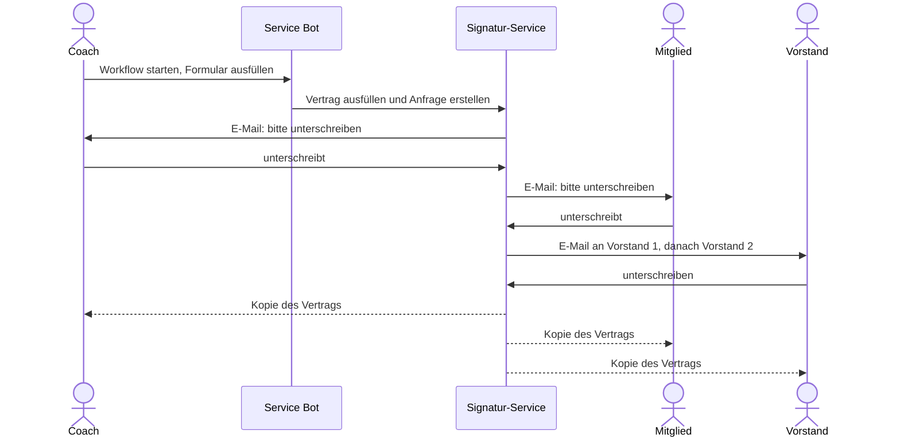

# Anleitung für Mitglieder

Hier steht, wie du die Funktionen des Bots in Slack benutzt.

| Funktion | Für wen | Beschreibung |
| --- | --- | --- |
| [Rechnung einreichen](#rechnung-einreichen) | alle Mitglieder | Ausgaben für den Verein mit Beleg einreichen |
| [Kontodaten ändern](#kontodaten-aendern) | alle Mitglieder | Neues SEPA-Mandat für den Mitgliedsbeitrag digital unterschreiben |
| [Coaching-Vertrag](#coaching-vertrag) | Vereinscoaches | Coaching-Vertrag in Slack ausfüllen und digital unterschreiben lassen |
| [Eigene Workflows](#eigene-workflows) | alle Mitglieder | Bausteine "Datum formatieren" und "URL kodieren" in eigenen Slack-Workflows verwenden |

Du richtest Workflows ein? Dann geht's weiter bei der [Anleitung für Admins](./admins).

## Rechnung einreichen {#rechnung-einreichen}

Du hast etwas für den Verein gekauft oder eine Rechnung erhalten, die der Verein bezahlen soll? Reich sie mit dem Workflow **Rechnung einreichen** ein. Der Vorstand prüft sie und kümmert sich um die Zahlung.

### So geht's {#rechnung-so-gehts}

1. Den Link zum Workflow **Rechnung einreichen** in Slack öffnen und starten.
2. Im Formular ausfüllen:
   - **Datum der Ausgabe**
   - **Titel der Ausgabe**, z. B. "Kreide und Tape"
   - **Rechnung noch offen?** ob die Rechnung noch offen ist, du sie privat ausgelegt hast oder sie schon vom Verein bezahlt wurde
   - **Paypal Konto** (optional): nur wenn du Geld ausgelegt hast und es per Paypal zurück möchtest. Leer lassen, wenn der Verein direkt bezahlt oder du eine Banküberweisung bekommst
   - **Rechnungsbeleg:** die Rechnung oder den Kassenbon als Datei hochladen (PDF oder Foto)
3. Abschicken. Du bekommst eine kurze Bestätigung, dass deine Ausgabe eingereicht wurde.

### Was danach passiert {#rechnung-danach}

1. Der Vorstand bekommt deine Einreichung und **genehmigt** sie.
2. Der Beleg wird automatisch benannt und in der Ablage des Vereins gespeichert.
3. Der Vorstand bekommt eine Aufgabe, die Rechnung zu bezahlen bzw. dir dein Geld zu überweisen.

## Kontodaten ändern {#kontodaten-aendern}

Du hast ein neues Konto und der Mitgliedsbeitrag soll ab einem bestimmten Datum von dort abgebucht werden? Dafür brauchst du ein neues SEPA-Lastschriftmandat, das du digital unterschreibst.

### So geht's {#kontodaten-so-gehts}

1. Den Link zum Workflow **Kontodaten ändern** in Slack öffnen und starten.
2. Im Popup **Änderung gültig ab** das Datum wählen, ab dem die neuen Kontodaten gelten sollen. Die Änderung braucht **1 bis 2 Wochen Vorlauf**, ein Datum in der Vergangenheit geht nicht.
3. Darunter siehst du die **E-Mail-Adresse** aus deinen Mitgliedsdaten, an die das Formular geschickt wird. Sie kann hier nicht geändert werden (siehe unten).
4. **Absenden.**
5. Du bekommst eine **E-Mail vom Signatur-Service** (DocuSeal) mit dem Formular für das neue SEPA-Mandat. Dort IBAN, BIC und ggf. eine:n abweichende:n Kontoinhaber:in eintragen und unterschreiben.

### Was danach passiert {#kontodaten-danach}

1. Der Vorstand bekommt das unterschriebene Mandat und **genehmigt** es.
2. Deine neuen Kontodaten werden in den Mitgliedsdaten gespeichert, das Mandat wird abgelegt.
3. Sobald der Vorstand die Umstellung erledigt hat, bekommst du in Slack Bescheid.

### Gut zu wissen {#kontodaten-gut-zu-wissen}

- **Falsche oder fehlende E-Mail-Adresse:** Das Formular geht aus Sicherheitsgründen immer nur an die Adresse aus deinen Mitgliedsdaten. Ist sie falsch oder fehlt, zuerst die Mitgliedsdaten ändern lassen. Sobald das genehmigt ist, den Workflow erneut starten.
- **Keine E-Mail bekommen?** Spam-Ordner prüfen. Konnte das Formular nicht verschickt werden, bekommst du vom Bot eine Nachricht in Slack.
- **Abbrechen:** Schließt du das Popup, wird nichts verschickt.

## Coaching-Vertrag {#coaching-vertrag}

Als Coach im Verein schließt du mit jedem Mitglied, das du coachst, einen Coaching-Vertrag ab. Der Bot füllt den Vertrag mit deinen Angaben aus und schickt ihn zur digitalen Unterschrift - Papier und Scannen entfallen.

::: info Für wen?
Nur für Vereinscoaches. Den Workflow findest du im Vereinscoaches-Channel.
:::

### So geht's {#coaching-so-gehts}

1. Öffne im **Vereinscoaches-Channel** den angepinnten Link zum Workflow und starte ihn.
2. Es öffnet sich das Formular **Coaching-Vertrag**:
   - **Deine Daten (Coach):** Vorname, Nachname, Straße und Hausnummer, PLZ und Ort.
   - **Speichern:** Ist der Haken gesetzt (Standard), merkt sich der Bot deine Daten und deine E-Mail-Adresse. Beim nächsten Vertrag sind sie dann schon ausgefüllt.
   - **Coaching:** Beginn des Coachings und monatliche Kosten in Euro.
   - **Beteiligte:** deine E-Mail-Adresse und die E-Mail-Adresse des Mitglieds. An diese Adressen geht die Anfrage zur Unterschrift, sie stehen nicht im Vertrag.
3. Mit **Weiter** abschicken. Fehlt etwas oder ist eine E-Mail-Adresse ungültig, zeigt das Formular den Fehler direkt am Feld an.

### Unterschriften {#coaching-unterschriften}

Der Vertrag geht nacheinander zur Unterschrift. Jede Person bekommt eine E-Mail mit einem Link, sobald sie an der Reihe ist:

1. **du** als Coach,
2. **das Mitglied** (Athlet),
3. **Vorstand 1**,
4. **Vorstand 2**.

Sobald alle unterschrieben haben, bekommt **jede:r eine Kopie** des unterschriebenen Vertrags per E-Mail.

### Gut zu wissen {#coaching-gut-zu-wissen}

- **Abbrechen:** Schließt du das Formular mit **Abbrechen**, wird nichts verschickt.
- **Gespeicherte Daten ändern:** Beim nächsten Vertrag die Felder einfach überschreiben und den Haken bei **Speichern** gesetzt lassen - die alten Daten werden ersetzt. Ohne Haken bleiben die bisher gespeicherten Daten unverändert.
- **E-Mail nicht angekommen?** Erst prüfen, ob die vorherige Person schon unterschrieben hat - die nächste Person wird erst danach benachrichtigt. Auch den Spam-Ordner prüfen.
- Was nach der Unterschrift im Verein passiert, erledigt der Vorstand.

## Eigene Workflows {#eigene-workflows}

In Slack kann jedes Mitglied mit dem **Workflow Builder** eigene Workflows bauen. Der Service Bot bringt dafür zwei Bausteine mit, die für alle freigegeben sind.

### Bausteine hinzufügen {#bausteine-hinzufuegen}

1. In Slack einen Workflow im Workflow Builder öffnen oder neu anlegen.
2. **Schritt hinzufügen** und nach dem Namen des Bausteins suchen (z. B. "Datum formatieren"), oder in der Liste der Apps **Schwerathletik Mannheim Bot** auswählen.
3. Eingaben ausfüllen - meist mit Variablen aus vorherigen Schritten, z. B. einem Datum aus einem Formular.
4. Das Ergebnis steht in allen folgenden Schritten als Variable zur Verfügung, z. B. in einer Nachricht.

### Datum formatieren {#datum-formatieren}

Slack liefert Datumsangaben im Format `2026-10-29`. Mit diesem Baustein wird daraus z. B. `29.10.2026`.

| Eingabe | Beschreibung |
| --- | --- |
| **Datum** | Das Datum, meist eine Variable aus einem vorherigen Schritt |
| **Format** | Wie das Ergebnis aussehen soll. `DD` wird durch den Tag, `MM` durch den Monat und `YYYY` durch das Jahr ersetzt |

| Format | Ergebnis für den 29.10.2026 |
| --- | --- |
| `DD.MM.YYYY` | `29.10.2026` |
| `YYYY-MM` | `2026-10` |
| `Meldeschluss: DD.MM.` | `Meldeschluss: 29.10.` |

Ausgabe: **Formatiertes Datum**.

### URL kodieren {#url-kodieren}

Wandelt einen Text so um, dass er gefahrlos als Teil eines Links verwendet werden kann. Leerzeichen, Umlaute und Sonderzeichen wie `&` oder `/` werden dabei z. B. zu `%20`, `%C3%BC`, `%26` bzw. `%2F`. Nützlich, wenn ein Link aus Variablen zusammengebaut wird, etwa ein Zahlungslink mit Verwendungszweck.

| Eingabe | Beschreibung |
| --- | --- |
| **Zeichenkette** | Der Text, der in den Link eingesetzt werden soll |

Ausgabe: **URL-kodierte Zeichenkette**.

::: tip Beispiel
Für den Link `https://example.com/zahlung?zweck=…` soll der Verwendungszweck `Meldung Müller & Co` eingesetzt werden:

1. Baustein **URL kodieren** mit `Meldung Müller & Co` → `Meldung%20M%C3%BCller%20%26%20Co`
2. In der Nachricht den Link als `https://example.com/zahlung?zweck=` + Ausgabe des Bausteins schreiben.

Nur den **eingesetzten Teil** kodieren, nicht den ganzen Link - sonst werden auch `:`, `/` und `?` des Links umgewandelt und er funktioniert nicht mehr.
:::
