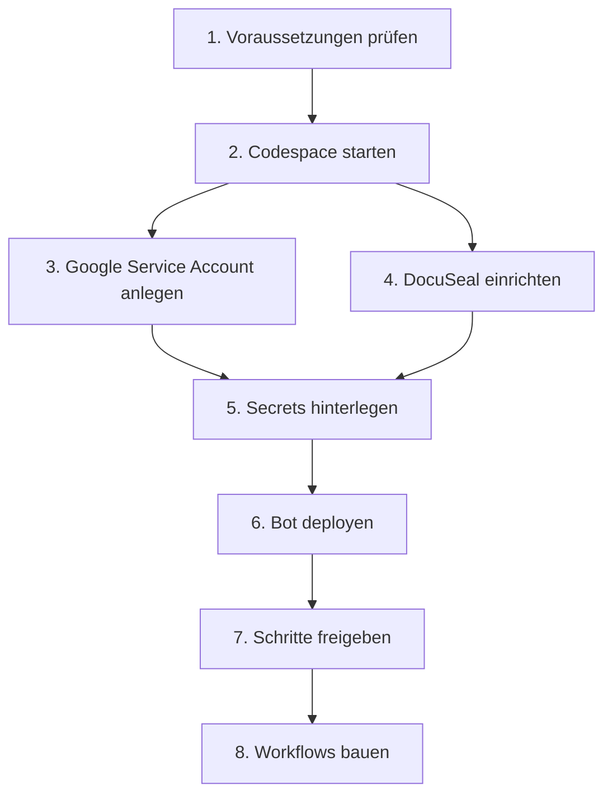

# Bot einrichten

Diese Seite führt Schritt für Schritt durch die Einrichtung des Bots - z. B. für einen neuen Workspace oder wenn die Zugänge neu angelegt werden müssen. Programmierkenntnisse sind nicht nötig, ein paar Befehle im Terminal aber schon. Alle Befehle laufen in einem GitHub Codespace, auf dem eigenen Rechner muss nichts installiert werden.

## Überblick



## 1. Voraussetzungen

- **Slack:** Workspace mit kostenpflichtigem Plan, Voraussetzung für Apps, die auf Slack laufen (der Verein nutzt den Nonprofit-Plan) und ein Konto mit Rechten zum Installieren von Apps.
- **GitHub:** Zugriff auf das Repository [Roy0815/slack-service-bot-deno](https://github.com/Roy0815/slack-service-bot-deno).
- **Google:** ein Google-Konto mit Zugriff auf die [Google Cloud Console](https://console.cloud.google.com/) und auf die Drive-Ordner des Vereins.
- **DocuSeal:** ein Konto bei [DocuSeal](https://www.docuseal.com/) (der Verein nutzt den EU-Server `docuseal.eu`).

## 2. Codespace starten

1. Auf GitHub im Repository den Branch **`dev`** auswählen (oder einen eigenen Branch davon anlegen) und dann **Code → Codespaces → Create codespace on dev** bzw. auf dem eigenen Branch wählen.

   ::: warning Nicht auf `main`
   Keinen Codespace auf `main` erstellen - `main` ist geschützt und entspricht dem produktiven Stand. Gearbeitet wird auf `dev` oder einem eigenen Branch.
   :::

2. Warten, bis der Codespace fertig ist. Er bringt Slack CLI, Deno und Node mit.
3. Im Terminal des Codespace bei Slack anmelden:

   ```bash
   slack login
   ```

   Die CLI zeigt einen Befehl `/slackauthticket ...` an. Diesen in Slack in einer beliebigen Nachricht abschicken, die Anmeldung bestätigen und den angezeigten Code zurück ins Terminal kopieren.

## 3. Google Service Account {#google-service-account}

Der Service Account ist das Google-Konto des Bots. Er braucht keinen eigenen Login, sondern meldet sich mit einem Schlüssel an.

1. In der [Google Cloud Console](https://console.cloud.google.com/) ein Projekt anlegen (oder ein bestehendes wählen).
2. Unter **APIs & Dienste → Bibliothek** die **Google Drive API** und die **Google Sheets API** aktivieren.
3. Unter **IAM & Verwaltung → Dienstkonten** ein Dienstkonto anlegen. Rollen sind nicht nötig.
4. Im Dienstkonto unter **Schlüssel → Schlüssel hinzufügen → Neuen Schlüssel erstellen → JSON** einen Schlüssel herunterladen.
5. Aus der JSON-Datei werden zwei Werte gebraucht:
   - `client_email` → wird zu `GOOGLE_SERVICE_ACC_EMAIL`
   - `private_key` → wird zu `GOOGLE_SERVICE_ACC_PRIVATE_KEY` (genau so, wie er in der Datei steht: eine Zeile mit `\n` darin)
6. Jeden Drive-Ordner, in den der Bot hochladen soll, für die `client_email` als **Bearbeiter:in** freigeben (siehe [Google Drive Ablage](../anleitung/admins#drive-ordner-vorbereiten)).
7. Das **Stammdaten-Sheet** ebenfalls für die `client_email` als **Bearbeiter:in** freigeben. Die ID des Sheets ist der Teil der URL zwischen `/d/` und `/edit` → wird zu `SPREADSHEET_ID_MASTERDATA`. Das Sheet braucht die Tabellenblätter **Allg Daten** und **SEPA Daten**.

::: danger
Die JSON-Datei ist ein Passwort. Nicht per Slack oder E-Mail verschicken und nach dem Eintragen der Secrets löschen.
:::

## 4. DocuSeal

1. Im DocuSeal-Konto unter **Settings → API** den **API Key** kopieren → wird zu `DOCUSEAL_API_KEY`.
2. Die Vorlage für den Coaching-Vertrag anlegen bzw. prüfen:
   - Rollen in genau dieser Reihenfolge: `Coach`, `Athlet`, `Vorstand 1`, `Vorstand 2`
   - Felder, alle der Rolle `Coach` zugeordnet: `firstName`, `lastName`, `street`, `cityPostalcode`, `coachingStartDate`, `monthlyRate`
3. Die Vorlage **Kontodaten ändern** (SEPA-Mandat) anlegen bzw. prüfen:
   - eine Rolle `Mitglied`
   - Felder: `accountOwner`, `IBAN`, `BIC`, `signingDate`
4. Die **Vorlagen-IDs** beider Vorlagen notieren (Zahl in der URL der Vorlage). Sie werden später im Workflow eingetragen, nicht im Bot.
5. Unter **Settings → Webhooks** muss der Webhook des Legacy-Bots (AWS Lambda) für das Ereignis "form completed" eingetragen sein. Er startet nach der Unterschrift den Genehmigungs-Workflow für [Kontodaten-Änderungen](../anleitung/admins#kontodaten-workflow-2) bzw. den Workflow [Neues Mitglied](../anleitung/admins#neues-mitglied).
6. `DOCUSEAL_API_URL` bleibt leer, solange das Konto auf dem EU-Server liegt. Für ein Konto auf dem US-Server `https://api.docuseal.com` eintragen.

## 5. Secrets hinterlegen

Die Zugangsdaten werden nicht im Code gespeichert, sondern als Secrets im Repository:

1. Auf GitHub im Repository **Settings → Secrets and variables → Codespaces** öffnen.
2. Für jeden Wert ein **Repository secret** anlegen:

| Secret | Wert |
| --- | --- |
| `GOOGLE_SERVICE_ACC_EMAIL` | `client_email` aus Schritt 3 |
| `GOOGLE_SERVICE_ACC_PRIVATE_KEY` | `private_key` aus Schritt 3 |
| `SPREADSHEET_ID_MASTERDATA` | ID des Stammdaten-Sheets aus Schritt 3 (ggf. als `DEV_`/`PROD_` getrennt, wenn es ein Test-Sheet gibt) |
| `PROD_DOCUSEAL_API_KEY` | API Key aus Schritt 4 |
| `DEV_DOCUSEAL_API_KEY` | optional: API Key eines Test-Kontos für die Entwicklung |
| `DOCUSEAL_API_URL` | nur bei US-Server, sonst weglassen |

3. Den Codespace neu bauen (**⇧⌘P / Strg+Shift+P → Codespaces: Rebuild Container**), damit die Secrets übernommen werden.

Warum manche Secrets ein Präfix haben, steht unter [Umgebungen & Secrets](./umgebungen#codespaces-secrets).

## 6. Bot deployen

Im Terminal des Codespace:

```bash
slack deploy
```

Beim ersten Mal fragt die CLI nach dem Workspace und installiert die App dort. Danach die Zugangsdaten an die deployte App übertragen:

```bash
npm run env:dry-run   # zeigt, was übertragen würde
npm run env:sync      # überträgt die Werte
```

Nach Änderungen an den Secrets reicht ein Rebuild des Codespace und erneut `npm run env:sync`. Nach Änderungen am Code (neuer Stand auf `main`) erneut `slack deploy`.

## 7. Schritte freigeben

Damit alle Mitglieder die Bausteine *Datum formatieren* und *URL kodieren* in eigenen Workflows nutzen können:

```bash
slack function access --name utility_format_date --everyone --grant
slack function access --name utility_encode_url --everyone --grant
```

Bei der Frage nach der App die **deployte** App wählen (nicht die mit "(local)"). Details und weitere Personen: [Freigabe von Schritten](./freigaben).

## 8. Workflows bauen

Die Workflows werden im Slack Workflow Builder angelegt, siehe [Anleitung für Admins](../anleitung/admins).

## Prüfen, ob alles läuft

```bash
slack activity --tail
```

zeigt die Logs der deployten App live an. Dann den Workflow in Slack starten und auf Fehlermeldungen achten.
