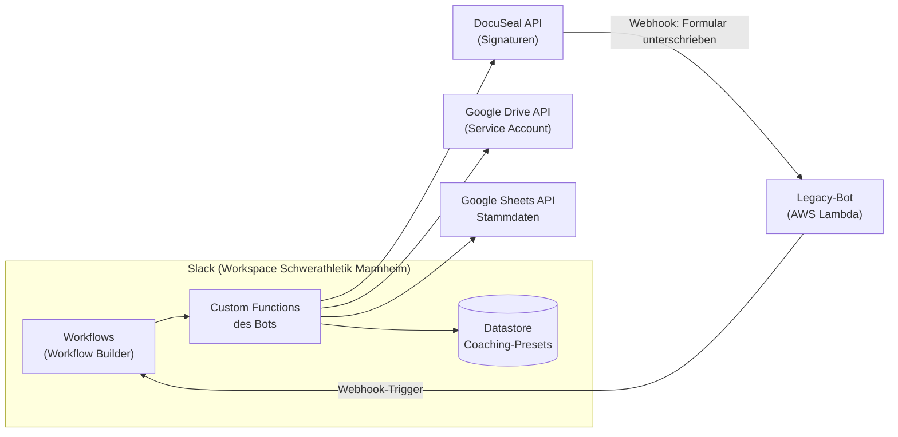

# Technische Doku

Alles rund um Installation, Betrieb und Entwicklung des Bots.

| Seite | Für wen | Inhalt |
| --- | --- | --- |
| [Bot einrichten](./bot-einrichten) | Admins, auch ohne Entwicklungserfahrung | Schritt für Schritt vom leeren Workspace bis zum laufenden Bot |
| [Umgebungen & Secrets](./umgebungen) | Entwickler:innen | Test- und Prod-Umgebung, Env-Dateien, Codespaces-Secrets |
| [Freigabe von Schritten](./freigaben) | Admins, Entwickler:innen | Wer welche Workflow-Schritte im Workflow Builder sieht |
| [Referenz Workflow-Schritte](./referenz) | Entwickler:innen | Alle Schritte mit Ein- und Ausgaben, `callback_id` und Abhängigkeiten |

## Architektur



- Der Bot basiert auf dem [Deno Slack SDK](https://docs.slack.dev/tools/deno-slack-sdk/) und läuft komplett auf der Infrastruktur von Slack ("Run on Slack") - es gibt keinen eigenen Server.
- Er stellt ausschließlich **Custom Functions** bereit, die im Workflow Builder als Schritte verwendet werden. Die Workflows selbst werden im Workflow Builder gepflegt, nicht im Code.
- Deployed wird über die [Slack CLI](https://docs.slack.dev/tools/slack-cli/).
- Eingehende Webhooks (z. B. von DocuSeal, wenn ein Formular unterschrieben wurde) nimmt aktuell noch der [Legacy-Bot](https://github.com/Roy0815/slack-service-bot) auf AWS Lambda entgegen und startet damit Workflows über deren Webhook-Trigger.

## Projektstruktur

- `manifest.ts` ist die zentrale Definition der App: registrierte Functions, Datastores, `outgoingDomains` und `botScopes`. **Nur Functions, die hier eingetragen sind, sind nach einem Deploy verfügbar.**
- Jede fachliche Domäne hat einen eigenen Ordner unter `src/` (`expenses`, `google_drive`, `masterdata`, `signatures`, `utility`) mit einem `functions/`-Unterordner. Jede Function besteht aus `definition.ts` (Input/Output-Schema) und `mod.ts` (Implementierung), ggf. mit `mod_test.ts`.
- Domänenübergreifender Code (z. B. Google-Auth, Stammdaten-Service, Channel-Zugriff, Hilfsfunktionen) liegt in `src/shared/`.
- `docs/` enthält diese Dokumentation (VitePress), siehe [Doku bearbeiten](#doku-bearbeiten).

## Externe Dienste

- **Google:** Zugriff auf Google Drive und Google Sheets (Stammdaten) läuft über einen Service Account, JWT-Auth in `src/shared/google_service_account.ts` (scope-parametrisiert, kein externes Paket nötig).
- **DocuSeal:** Signatur-Service für den Coaching-Vertrag und das SEPA-Mandat bei Kontodaten-Änderungen. Die Anbindung ist hinter einem Provider-Interface gekapselt (`src/signatures/lib/provider.ts`), sodass ein Wechsel des Dienstes nur `docuseal.ts` und eine Zeile in `provider.ts` betrifft.
- Jede Domain, die der Bot aufruft, muss im Manifest unter `outgoingDomains` freigegeben sein, sonst blockt die Slack-Laufzeitumgebung den Request.

## Entwicklung

```bash
slack run       # lokale Dev-App, liest .env
deno task test  # Formatierung, Lint und Unit-Tests
slack deploy    # deployte App aktualisieren
```

Gearbeitet wird auf `dev`, `main` entspricht dem produktiven Stand.

## Doku bearbeiten

```bash
npm install
npm run docs:dev    # lokale Vorschau mit Live-Reload
npm run docs:build  # Build wie in der Pipeline
```

Die Doku wird bei jedem Push auf `main`, der `docs/` betrifft, per GitHub Action (`.github/workflows/deploy-docs.yml`) auf [GitHub Pages](https://schwerathletik-mannheim-2018-e-v.github.io/slack-service-bot-deno/) veröffentlicht. Sie beschreibt nur, was auf `main` live ist.
